# BÁO CÁO ĐỒ ÁN KHOA HỌC: HỆ THỐNG QUẢN LÝ SINH VIÊN TOÀN DIỆN

**Công nghệ sử dụng:** C# WinForms (.NET Framework), SQL Server, ADO.NET.  
**Kiến trúc phần mềm:** 3-Tier Architecture (Mô hình 3 lớp) kết hợp Data Transfer Object (DTO).  
**Giao diện đồ họa:** GDI+ (System.Drawing) hỗ trợ in ấn.

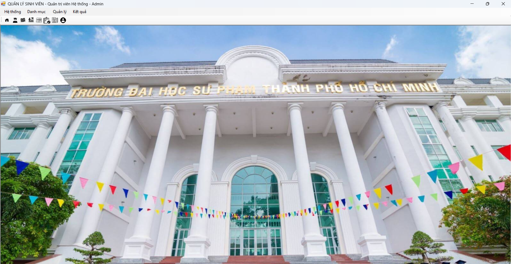
*Hình 1: Giao diện chính (MDI Parent) của Hệ thống Quản lý Sinh viên*

---

## BẢNG PHÂN CÔNG VÀ ĐÓNG GÓP CỦA THÀNH VIÊN

| Thành viên | Phụ trách chính | Công việc cụ thể | Đóng góp |
| :--- | :--- | :--- | :---: |
| **Chương – CSDL & tích hợp dữ liệu** | Nền tảng dữ liệu + hỗ trợ tích hợp | Tạo Database.sql, ERD, DTO, DAL, BLL. Kiểm tra App.config/SQL Server; hỗ trợ lỗi dữ liệu; kiểm tra stored procedure, truy vấn, DataTable; hỗ trợ Binding/ComboBox và kiểm thử. PrintPreview/PrintDocument. Làm bài Báo Cáo | **100%** |
| **Tín – Sinh viên** | GUI Sinh viên | FrmSinhVien; DataGridView; thêm/sửa/xóa; tìm kiếm/lọc; ComboBox Khoa/Lớp; DateTimePicker; kiểm tra dữ liệu từ BLL. Làm bài Báo Cáo | **100%** |
| **Thái – Danh mục & Kết quả** | GUI Khoa/Lớp/Môn học/Kết quả | FrmKhoa, FrmLop, FrmMonHoc, FrmKetQua, FrmTaoTaiKhoan, FrmHocPhi; ComboBox liên kết; nhập/sửa/xem điểm; tính điểm trung bình; chức năng in ấn. | **100%** |
| **Trầm – Đăng nhập & tích hợp** | Login + MDI + phân quyền + in ấn | FrmDangNhap, FrmMain MDI; phân quyền; MenuStrip/ToolStrip/StatusStrip; tích hợp Form; tổng hợp README, slide, demo. Làm bài Báo Cáo | **100%** |

---

## 1. TỔNG QUAN DỰ ÁN

Hệ thống Quản lý Sinh viên là một ứng dụng phần mềm Desktop được thiết kế nhằm tin học hóa và tối ưu hóa các quy trình quản lý học vụ tại môi trường Đại học/Cao đẳng. Dự án giải quyết trọn vẹn bài toán lưu trữ thông tin và tích hợp các module nghiệp vụ chuyên sâu:

* Đánh giá học lực tự động qua điểm số GPA.
* Render và in ấn Thẻ sinh viên, Bảng điểm bằng thư viện đồ họa (`System.Drawing`).
* Hạch toán học phí tự động dựa trên tổng tín chỉ và chính sách miễn giảm đặc thù theo **Nghị định 116** của Chính phủ.
* Quản trị bảo mật, phân quyền nghiêm ngặt theo vai trò người dùng.

## 2. KIẾN TRÚC HỆ THỐNG (SYSTEM ARCHITECTURE)

Dự án áp dụng mô hình **Kiến trúc 3 Lớp (3-Tier)**, phân tách rõ ràng trách nhiệm của từng thành phần mã nguồn, giúp hệ thống dễ bảo trì, mở rộng và tăng khả năng tái sử dụng:

1. **Presentation Layer (Tầng Giao diện - GUI):**
   * Bao gồm các Windows Forms (`FrmMain`, `FrmSinhVien`, `FrmKetQua`...).
   * Đảm nhận việc tiếp nhận sự kiện, validate bề mặt, hiển thị dữ liệu lên `DataGridView`, `ComboBox` (sử dụng `DisplayMember`, `ValueMember`). Giao diện hoàn toàn không chứa bất kỳ câu lệnh SQL nào.

2. **Business Logic Layer (Tầng Nghiệp vụ - BLL):**
   * Đóng vai trò là "bộ não" của hệ thống (`SinhVienBLL`, `LopBLL`...).
   * Trước khi gọi xuống DAL, BLL sẽ kiểm tra toàn bộ các điều kiện nghiệp vụ (Business Rules). Nếu dữ liệu sai lệch, tầng này sẽ ném ra các ngoại lệ (`throw new Exception`) với thông báo tiếng Việt để GUI hiển thị cho người dùng.

3. **Data Access Layer (Tầng Truy cập Dữ liệu - DAL):**
   * Chịu trách nhiệm giao tiếp trực tiếp với cơ sở dữ liệu thông qua lớp tiện ích `Database.cs`.
   * Sử dụng `SqlParameter` 100% cho mọi truy vấn để ngăn chặn tuyệt đối rủi ro **SQL Injection**. Tận dụng tối đa **Stored Procedures** để tăng tốc độ truy vấn và bảo mật cấu trúc DB.

4. **Data Transfer Object (DTO):**
   * Các POCO class (`SinhVienDTO`, `KetQuaDTO`...) chứa các thuộc tính (Properties) dùng làm "vật chứa" để vận chuyển dữ liệu một cách an toàn xuyên suốt 3 lớp trên.

---

## 3. CHI TIẾT CHỨC NĂNG & XỬ LÝ NGOẠI LỆ (EDGE CASES & HANDLING)

### 3.1. Phân quyền và Xác thực (Authentication)

Hệ thống cấp quyền truy cập linh hoạt dựa trên 3 vai trò (Role): **Admin**, **GiaoVu**, và **GiangVien**.

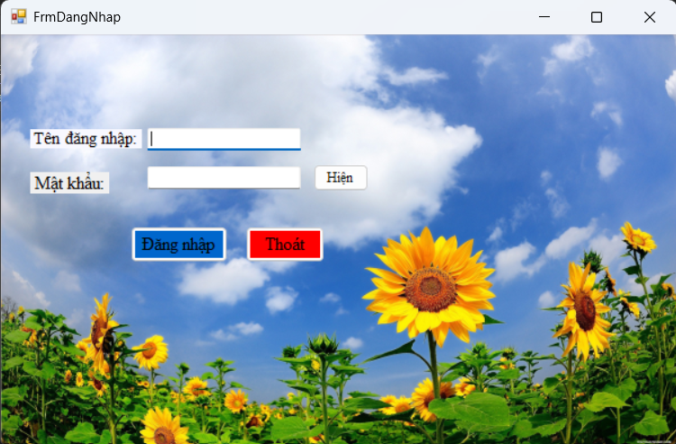
*Hình 2: Màn hình đăng nhập hệ thống*

* **Tính năng:**
  * Đăng nhập với cơ chế mã hóa ký tự `UseSystemPasswordChar`. Nút "Hiện/Ẩn" cho phép xem mật khẩu linh hoạt.
  * Tự động ẩn/hiện Menu, ToolStrip trên `FrmMain` theo quyền:
    * `Admin`: Toàn quyền hệ thống, quản lý tài khoản, kế toán học phí.
    * `GiaoVu`: Quản lý danh mục Khoa, Lớp, Môn học, Hồ sơ sinh viên và Điểm số.
    * `GiangVien`: Chỉ xem danh sách sinh viên, lọc sinh viên và quản lý điểm số.
  * Khi bấm đăng xuất, hệ thống đóng toàn bộ Form con (MDI Children) và xóa trắng cache tên đăng nhập.

* **Xử lý lỗi & Ràng buộc:**
  * **Lỗi bỏ trống:** Chặn ngay ở UI nếu người dùng không nhập Tài khoản hoặc Mật khẩu, tự động `Focus()` vào ô văn bản bị lỗi.

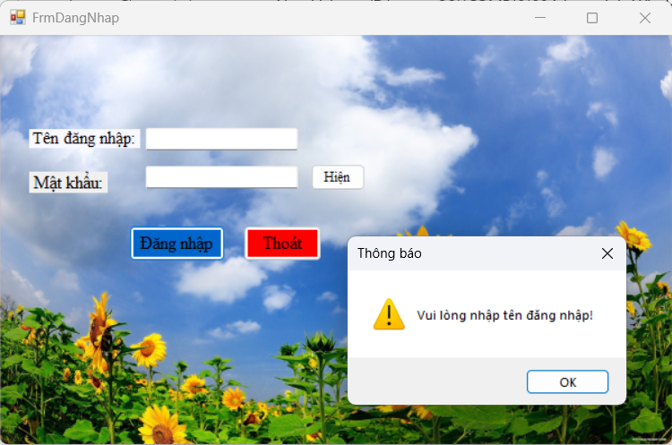
*Hình 2.1: Thông báo khi bỏ trống*

  * **Lỗi xác thực:** Truy vấn Stored Procedure `sp_KiemTraDangNhap`. Nếu không có kết quả, `TaiKhoanBLL` ném ngoại lệ *"Tên đăng nhập hoặc mật khẩu không chính xác!"*.

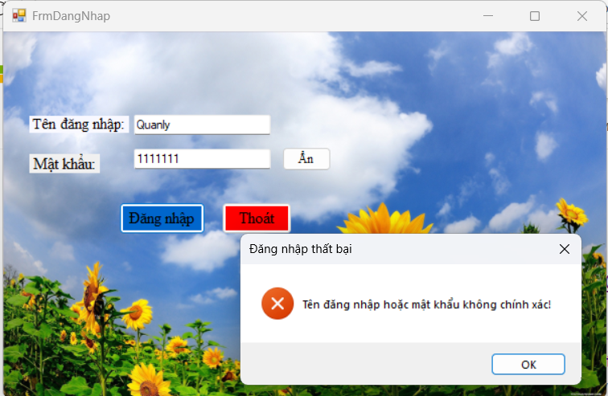
*Hình 2.2: Thông báo khi sai thông tin đăng nhập*

  * **Điều hướng MDI:** Ngăn chặn mất dữ liệu bằng hộp thoại xác nhận khi người dùng bấm về "Trang chủ" trong lúc các cửa sổ nhập liệu vẫn đang mở.

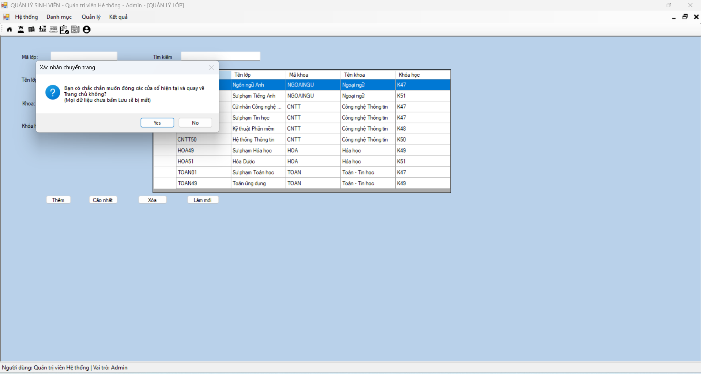
*Hình 2.3: Thông báo khi ấn về trang chủ*

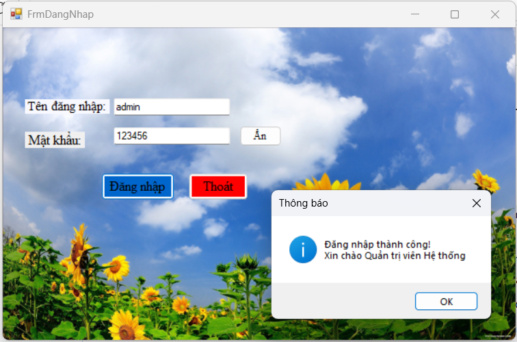
*Hình 2.4: Thông báo khi đăng nhập thành công*

### 3.2. Quản lý Danh mục (Khoa, Lớp, Môn Học)

Thực hiện chuẩn CRUD cho các danh mục cốt lõi.

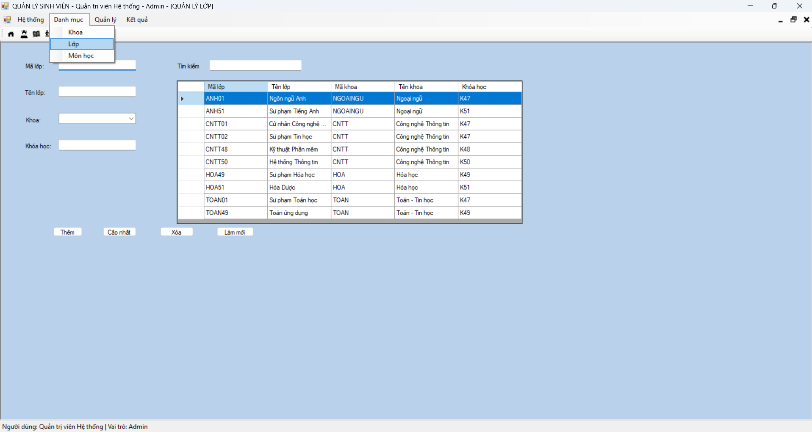
*Hình 3: Giao diện quản lý Lớp học và ComboBox liên kết Khoa*

* **Tính năng:**
  * Tìm kiếm Real-time bằng `DataView.RowFilter` giúp lọc ngay lập tức theo Mã hoặc Tên khi gõ phím.
  * Ràng buộc ComboBox Khoa-Lớp đồng bộ.

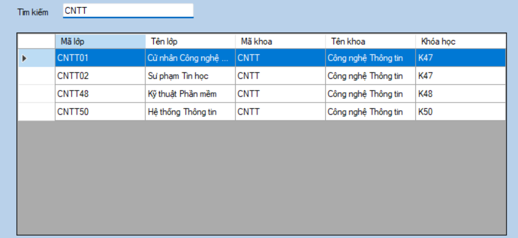
*Hình 3.1: Tính năng tìm kiếm khi tìm các lớp mã CNTT*
  
* **Xử lý lỗi & Ràng buộc:**
  * **Toàn vẹn Dữ liệu (Validation):** Không cho phép bỏ trống Mã/Tên Khoa, Lớp, Môn học. Số tín chỉ của Môn học phải được parse bằng `int.TryParse` và bắt buộc **> 0**.

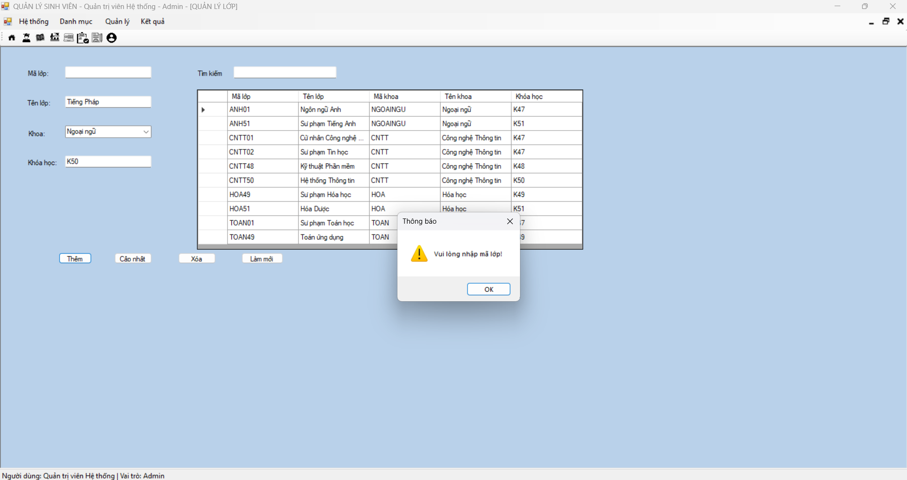
*Hình 3.2: Thông báo yêu cầu không được bỏ trống*

  * **Trùng lặp Khóa chính (Primary Key Violation):** Gọi hàm `KiemTraTrungMa` dưới DAL, chặn và báo lỗi *"Mã [X] đã tồn tại trong hệ thống!"* khi người dùng cố thêm mã cũ.

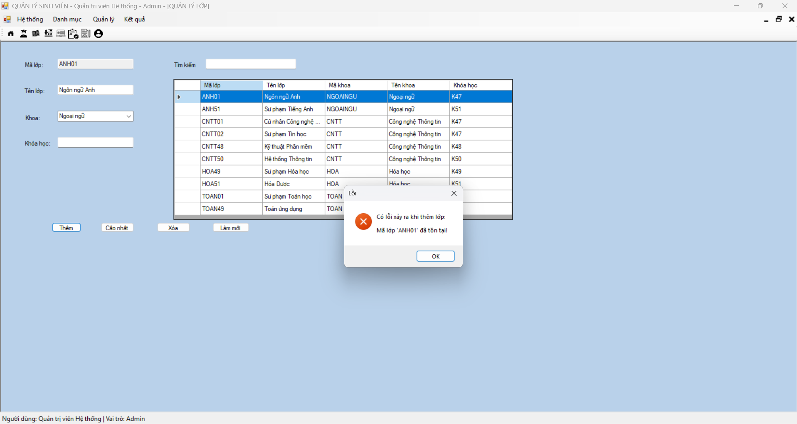
*Hình 3.3: Thông báo khi nhập mã lớp trùng lặp*

  * **Lỗi Ràng buộc Khóa ngoại (Foreign Key Constraint):**
    * Khi bấm nút Xóa, BLL bẫy lỗi từ SQL Server (`try...catch`). 
    * Nếu Khoa đang có Lớp học -> Báo lỗi: *"Không thể xóa khoa này do đang có lớp học trực thuộc!"*.
    * Nếu Lớp đang có Sinh viên -> Báo lỗi: *"Không thể xóa lớp này do đang có sinh viên theo học!"*.
    * Nếu Môn học đã có Điểm -> Báo lỗi: *"Không thể xóa môn học này vì đã có dữ liệu điểm thi!"*.

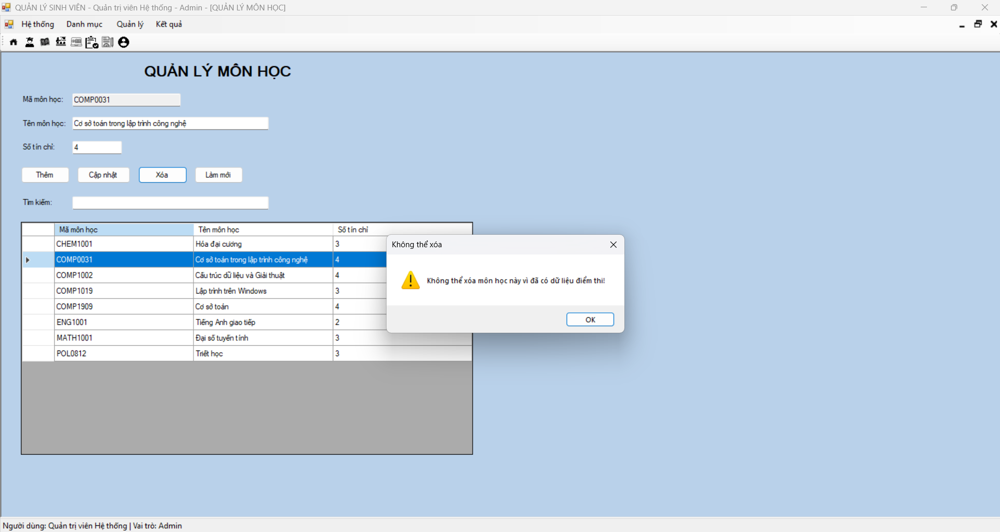
*Hình 3.4: Thông báo khi xóa mã môn học vì môn đã có dữ liệu ràng buộc*

### 3.3. Quản lý Hồ sơ Sinh viên toàn diện

Module đồ sộ quản lý nhân trắc học, liên kết đa chiều và tệp tin vật lý.

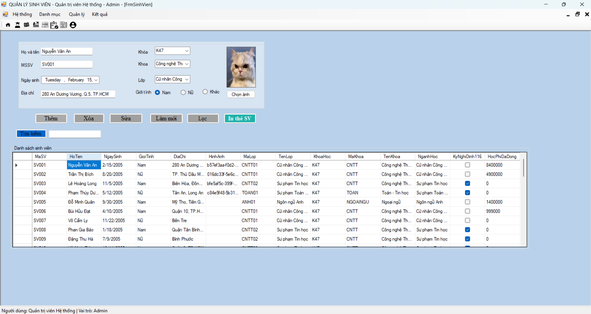
*Hình 4: Giao diện quản lý Hồ sơ sinh viên, upload ảnh và lọc dữ liệu đa chiều*

* **Tính năng:**
  * Thêm, sửa, xóa, tìm kiếm sinh viên.
  * **Quản lý Hình ảnh:** Cho phép browse chọn ảnh từ máy. Ảnh được copy vào thư mục `Images/` của ứng dụng, đổi tên tự động bằng hàm `Guid.NewGuid()` nhằm ngăn chặn xung đột tên file.

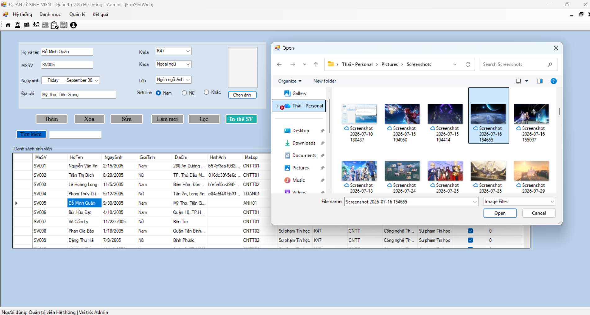
*Hình 4.1: Giao diện quản khi upload ảnh*

  * **Bộ lọc động (Dynamic Filter):** Truyền các tham số tìm kiếm (Mã Khoa, Mã Lớp, Khóa Học) xuống Stored Procedure `sp_LocSinhVienSS`. SP này xử lý thông minh: bỏ qua các tiêu chí bị bỏ trống.
  * **In thẻ Sinh viên (GDI+):** Sử dụng đối tượng `Graphics` vẽ viền thẻ, chèn logo Đại học, in text tọa độ chuẩn xác.

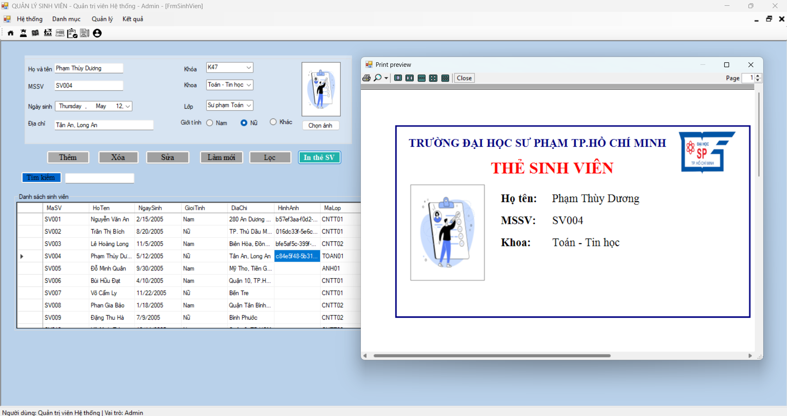
*Hình 4.2: Giao diện khi in thẻ*  

* **Xử lý lỗi & Ràng buộc:**
  * **Validation ComboBox:** Bắt lỗi `SelectedIndex == -1` hoặc `SelectedValue == null` tránh crash ứng dụng khi truyền `null` xuống SQL.
  * **Bảo vệ hiển thị Ảnh:** Nếu thuộc tính HinhAnh trong CSDL rỗng hoặc file vật lý bị xóa mất, khối `try...catch` sẽ gọi hàm `DrawEmptyPhotoBox()` để vẽ khung xám *"Không có ảnh"* thay vì crash hệ thống.
  * **Kiểm tra rỗng trước khi in:** Cảnh báo *"Vui lòng chọn một sinh viên trên danh sách để in thẻ!"* nếu cố tình gọi `PrintPreviewDialog` lúc lưới đang trống.

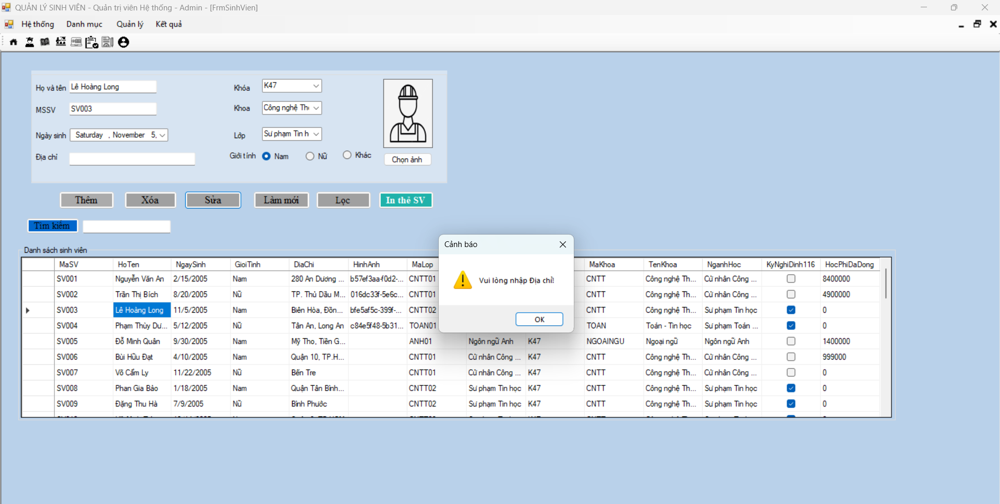
*Hình 4.3: Thông báo khi nhập thiếu thông tin bất kỳ( địa chỉ)*    

### 3.4. Quản lý Điểm số & Xét học vụ (GPA)

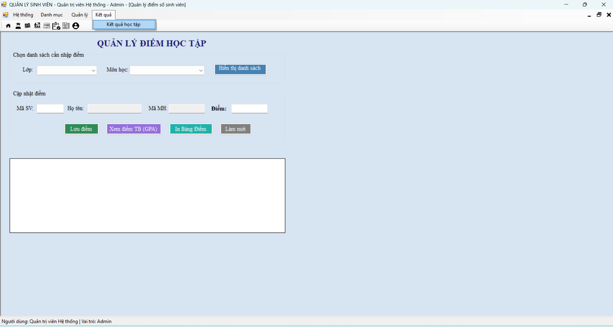
*Hình 5: Tính năng Nhập điểm*

* **Tính năng:**
  * **Danh sách Nhập điểm thông minh:** SP `sp_LayDanhSachNhapDiem` dùng `LEFT JOIN` KetQua lên SinhVien, trả về toàn bộ lớp. Dòng nào Diem rỗng (chưa thi) sẽ tự động bị bôi vàng `Color.LightYellow` trên Grid.
  * **Cơ chế Upsert Điểm:** Khi lưu, DAL dùng kịch bản `IF EXISTS... UPDATE... ELSE... INSERT`. Sinh viên chưa có điểm sẽ Insert, đã có sẽ Update đè lên điểm cũ.
  * **Tính điểm GPA & Xếp loại:** Tự động quy đổi điểm hệ 10 sang hệ 4 thông qua bộ lọc thang điểm chữ (A, B+, B, C...). Tính trung bình tích lũy và xuất Xếp loại học lực (Xuất sắc, Giỏi, Khá, Trung bình...).
  * **In Bảng điểm cá nhân:** GDI+ vẽ table 5 cột với font "Times New Roman", tích hợp dòng tổng kết Tín chỉ/GPA ở cuối bảng.

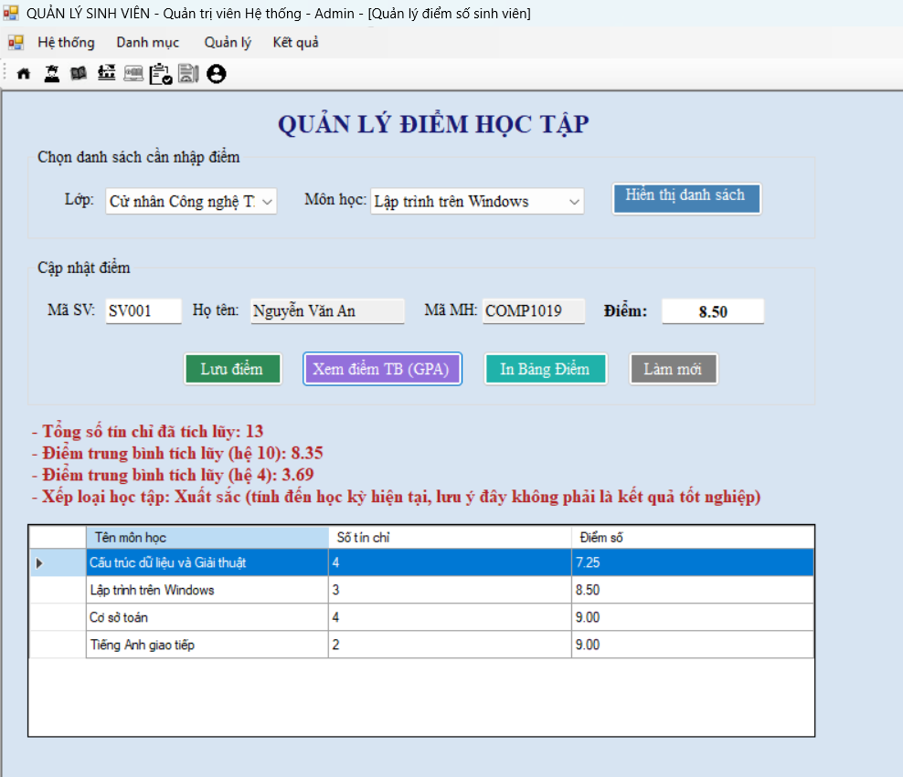
*Hình 5.1: Tính năng tính điểm*

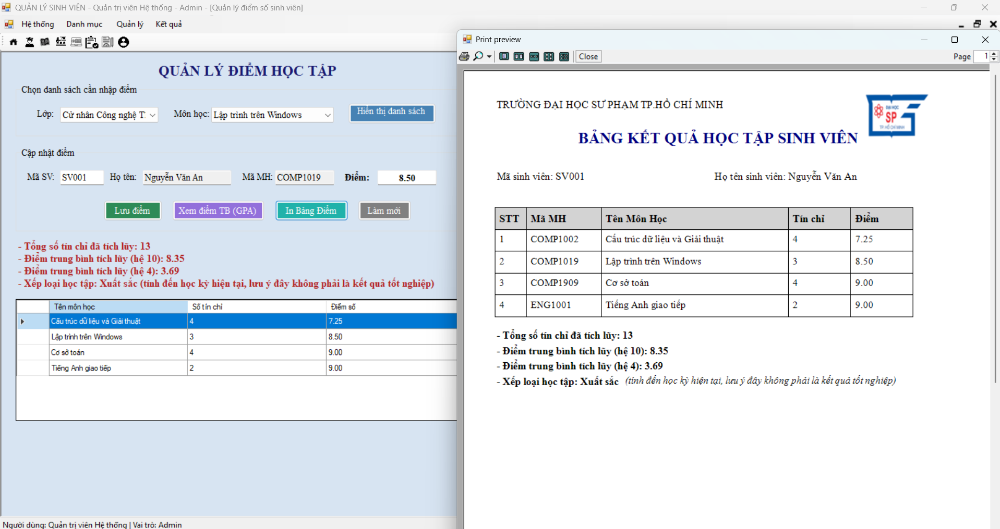
*Hình 5.2: Tính năng in bảng điểm sinh viên*  

* **Xử lý lỗi & Ràng buộc:**
  * Bắt buộc ô nhập Điểm phải là định dạng thập phân `decimal.TryParse`.
  * **Miền giá trị an toàn:** Ném ngoại lệ *"Điểm số phải nằm trong thang điểm [0 - 10]"* ở cả tầng BLL và ràng buộc `CHECK (Diem >= 0 AND Diem <= 10)` ở Database.
  * **Ngăn chặn in ấn sai quy trình:** Nếu giảng viên chưa bấm "Xem điểm TB" (tải bảng điểm cá nhân) mà bấm nút in thẳng trên danh sách lớp, cảnh báo *"Lưới dữ liệu hiện tại chưa có bảng điểm cá nhân..."* sẽ xuất hiện.

### 3.5. Kế toán Học phí (Tuition & Financial)

Module độc quyền của Admin, xử lý tài chính tự động.

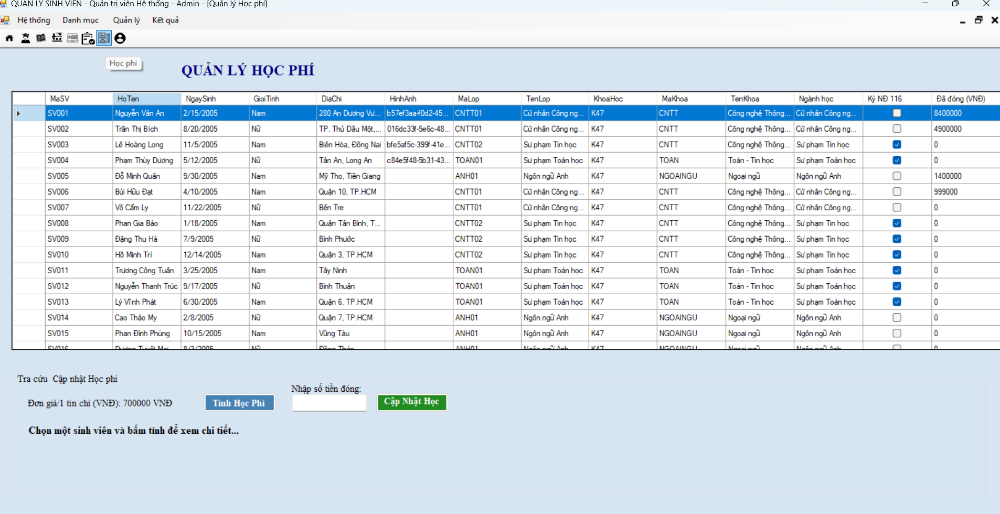
*Hình 6: Phân hệ Kế toán Học phí hiển thị công nợ và Nghị định 116*

* **Tính năng:**
  * Tính tổng nợ: Tổng số tín chỉ (lấy từ bảng KetQua) x Đơn giá 700.000 VNĐ.
  * **Logic Nghị định 116:** Sinh viên ngành Sư phạm (có cờ `KyNghiDinh116 = 1` trong DB) sẽ tự động nhảy kết quả Học phí = 0đ và bỏ qua dư nợ. Label thông tin tự động chuyển màu Xanh lá để đánh dấu.
  * Hiển thị trạng thái "CÒN NỢ" bằng màu đỏ (Firebrick) và "HẾT NỢ" bằng màu xanh (Blue) để kế toán dễ quan sát.

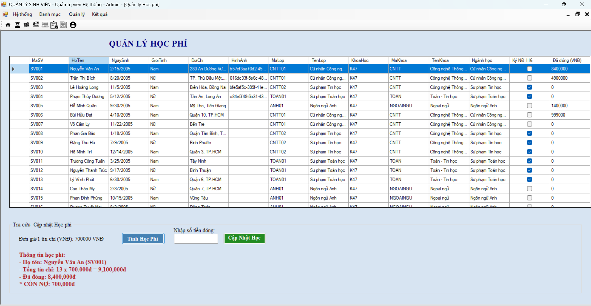
*Hình 6.1: Trường hợp sinh viên chưa đóng đủ học phí*

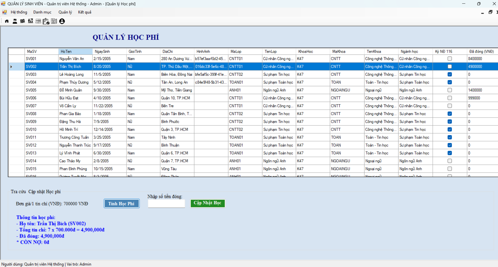
*Hình 6.2: Trường hợp sinh viên đã đóng đủ học phí*

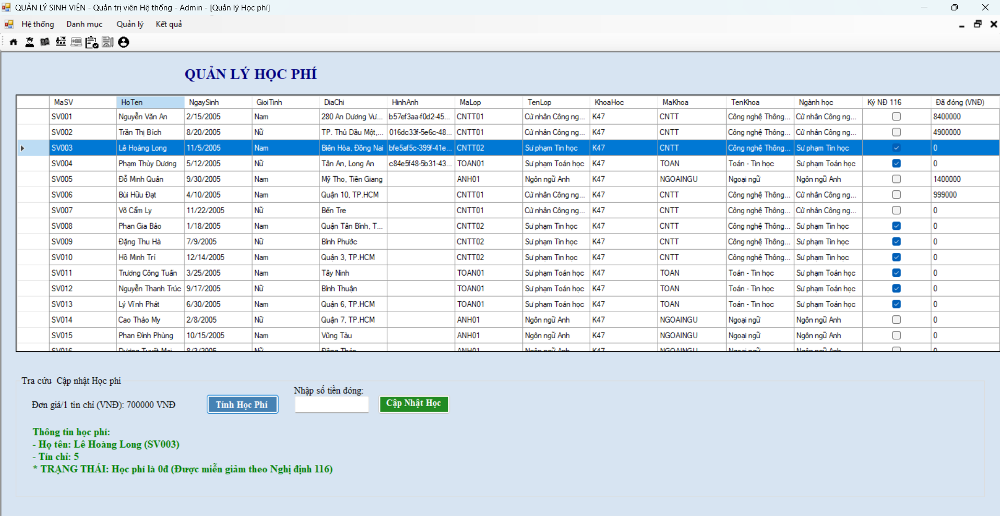
*Hình 6.3: Trường hợp sinh viên có ký Nghị định 116*
* **Xử lý lỗi & Ràng buộc:**
  * **Bảo mật giao diện:** Tài khoản không phải Admin sẽ bị `Visible = false` đối với ô nhập tiền và nút cập nhật, tránh xâm phạm thao tác.
  * Chặn nhập số âm, chặn nhập ký tự chữ vào ô Đóng học phí. Ngăn chặn lỗi trừ dư (đóng dư) dẫn đến nợ âm.

### 3.6. Cấu hình Tài khoản Người dùng

* **Tính năng:** Cấp phát tài khoản mới cho nhân sự (Admin sử dụng).
* **Xử lý lỗi & Ràng buộc:**
  * **Chiều dài Mật khẩu:** Tối thiểu 6 ký tự.
  * **Chặn nhập sai Vai trò:** ComboBox `DropDownStyle = DropDownList` cấm gõ tay, ép nhận các giá trị cứng (Admin, GiaoVu, GiangVien).
  * **Bắt trùng Username SQL:** Stored Procedure `sp_TaoTaiKhoan` sử dụng biến `@KetQua OUTPUT`. Nếu Username tồn tại, trả về 0. BLL dịch số 0 này thành hộp thoại cảnh báo: *"Tên đăng nhập đã tồn tại trong hệ thống..."*, đồng thời bôi đen (SelectAll) TextBox để nhập lại.

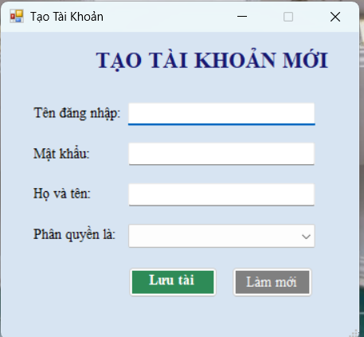
*Hình 6: Giao diện chức năng tạo tài khoản*

## 4. CẤU TRÚC CƠ SỞ DỮ LIỆU SƠ LƯỢC

### 4.1. Hệ thống Bảng (Tables)
1. **TaiKhoan:** `TenDangNhap (PK)`, `MatKhau`, `HoTen`, `VaiTro`
2. **Khoa:** `MaKhoa (PK)`, `TenKhoa`
3. **Lop:** `MaLop (PK)`, `TenLop`, `MaKhoa (FK)`, `KhoaHoc`
4. **MonHoc:** `MaMH (PK)`, `TenMH`, `SoTinChi`, `DonGiaTinChi`
5. **SinhVien:** `MaSV (PK)`, `HoTen`, `NgaySinh`, `GioiTinh`, `DiaChi`, `HinhAnh`, `MaLop (FK)`, `NganhHoc`, `KyNghiDinh116`, `HocPhiDaDong`
6. **KetQua:** `MaSV (PK, FK)`, `MaMH (PK, FK)`, `Diem` (Bảng trung gian n-n).

### 4.2. Các Stored Procedures cốt lõi
* `sp_KiemTraDangNhap`: Truy vấn an toàn xác thực đăng nhập.
* `sp_LocSinhVienSS`: Xử lý bộ lọc liên hoàn với điều kiện thông minh `(@MaKhoa IS NULL OR k.MaKhoa = @MaKhoa)`.
* `sp_TinhDiemTrungBinh`: Truy vấn tính GPA hệ 10 trên toàn bộ môn đã thi bằng cấu trúc `SUM(Diem * SoTinChi) / SUM(SoTinChi)`.
* `sp_LayDanhSachNhapDiem`: Sử dụng `LEFT JOIN` linh hoạt hiển thị cả lớp dẫu sinh viên chưa có cột điểm.

---

## 5. Biên dịch Khởi chạy và Kiểm thử
Build dự án. Đăng nhập bằng 1 trong 3 tài khoản mặc định dưới đây để test tính năng phân quyền:
* **Quản trị viên (Admin):** Tài khoản `admin` / Mật khẩu `123456`
* **Giáo vụ (GiaoVu):** Tài khoản `giaovu` / Mật khẩu `123456`
* **Giảng viên (GiangVien):** Tài khoản `giangvien` / Mật khẩu `123456`